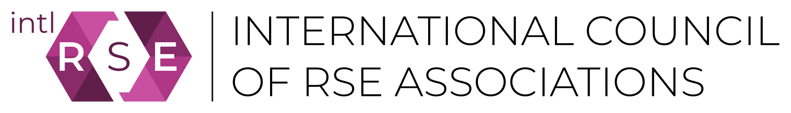

The different existing [national and multinational associations](./assoc.md)
have always informally talked and collaborated by a variety of means.

The **International Council of RSE Associations** (*the Council*) provides a
formal open forum for established national and multinational RSE associations
to talk and coordinate about RSE-related issues regularly, and thus sustain international collaboration around research software engineering/engineers.

The Council consists of delegates from the established RSE associations, who
meet regularly to coordinate, discuss and collaborate around research software engineering/engineers. It is governed by a
[charter](council/charter.html). Further national or multinational RSE
associations can join the Council once they pass a threshold for establishment
that is defined in the charter.

To maintain openness towards the community and facilitate further knowledge
exchange and support, representatives of nascent communities can join Council
meetings as observing participants, ask questions and discuss issues at the
end of meetings.

To get in touch with the Council, write an email to  
📧 [intl-rse-council@listserv.dfn.de](mailto:intl-rse-council@listserv.dfn.de).

For more information, also read
[this blog post from the 2nd International RSE Leaders Workshop 2020](https://researchsoftware.org/2021/01/27/introducing-the-international-council-of-RSE-associations.html).

Read the [Charter of the International Council of RSE Associations](council/charter.html) or download it as a [PDF file](International-Council-of-RSE-Associations_Charter.pdf).

See [A Brief History of the International Council of RSE Associations](https://researchsoftware.org/2026/11/13/council-history.html).

The Council has a [*Code of Conduct*](./council/code-of-conduct.md), and you are expected to honour it in any participation in or interaction with the Council.
  
## Current member associations and representatives

| Association | Name | Email |
| -----------: | :--------------| :--------------|
| [ BE-RSE](https://be-rse.org/)  | Alexander Botzki | <alexander.botzki@vib.be> |
| [ BE-RSE](https://be-rse.org/)  | Johan Philips | <johan.philips@kuleuven.be> |
| [ de-RSE](http://de-rse.org/)  | Anna-Lena Lamprecht| <anna-lena.lamprecht@uni-potsdam.de> |
| [ de-RSE](http://de-rse.org/)  | Claire Wyatt | <cl.wyatt@fz-juelich.de> |
| [ de-RSE](http://de-rse.org/)  | Frank Löffler | <frank.loeffler@de-rse.org> |
| [ de-RSE](http://de-rse.org/)  | Stephan Druskat | <s.druskat@tu-braunschweig.de> |
| [ devLOG](https://www.devlog.cnrs.fr/)  | Karin Dassas| tbc |
| [ devLOG](https://www.devlog.cnrs.fr/)  | Dirk Hoffman | tbc |
| [ NL-RSE](http://nl-rse.org/)  | Thomas Pronk | <t.pronk1@amsterdamumc.nl> |
| [ NL-RSE](http://nl-rse.org/)  | Yan Grange | <grange@astron.nl> |
| [ Nordic-RSE](http://nordic-rse.org/)  | Samantha Wittke | <samantha.wittke@csc.fi> |
| [ Nordic-RSE](http://nordic-rse.org/)  | Matteo Tomasini | <matteo.tomasini@gu.se> |
| [ RSCAN](https://github.com/alliancecan/RSCAN) | Ockmer Oosthuizen | <ockmer.oosthuizen@alliancecan.ca> |
| [ RSCAN](https://github.com/alliancecan/RSCAN) | Fares Dhane | <fares.dhane@alliancecan.ca> |
| [ RSE-AUNZ](https://rse-aunz.github.io/) | Peter Marendy | tbc |
| [ Soc RSE](https://society-rse.org/) | Laura Crawford | <m.simpson@society-rse.org> |
| [ Soc RSE](https://society-rse.org/) | Mike Simpson | <m.simpson@society-rse.org> |
| [ US-RSE](http://us-rse.org/) | Keith Beattie | <ksbeattie@lbl.gov> |
| [ US-RSE](http://us-rse.org/)  | Ian Cosden | <icosden@princeton.edu> |

## Observer associations

| Association | Name | Email |
| -----------: | :--------------| :--------------|
| [ RSE Argentina](https://rse-argentina.github.io/)| Patricia Loto | <rse.comunidad.argentina@gmail.com> |
| [ RSE Argentina](https://rse-argentina.github.io/)| Andrea Gomez Vargas | <rse.comunidad.argentina@gmail.com> |
| [RSE Asia](https://rse-asia.github.io/RSE_Asia/) | Saranjeet Kaur | <kaur.saranjeet3@gmail.com> |
| [RSE Asia](https://rse-asia.github.io/RSE_Asia/) | Jyoti Bhogal | <bhogaljyoti1@gmail.com> |
| [ RSE Chile](https://rse-chile.github.io/) | Riva Quiroga | <rivaquiroga@gmail.com> |
| [ RSE Chile](https://rse-chile.github.io/) | Sara Acevedo | <seaceved@uc.cl> |
| [RSSE Africa](https://rsse.africa/) | Anelda van der Walt | <team@rsse.africa> |
| [ Swiss RSE Community](https://rse.swiss/) | Uwe Schmitt | <uwe.schmitt@id.ethz.ch> |
